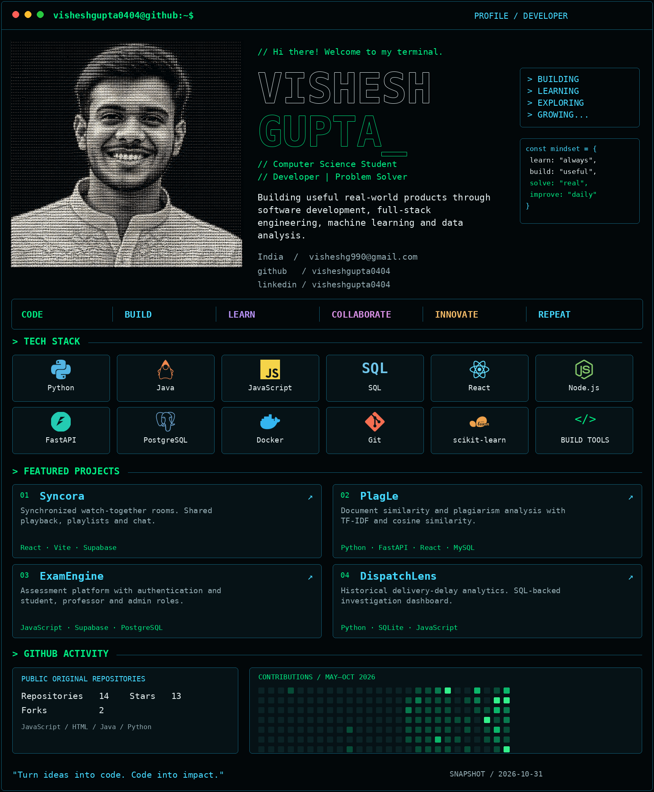

<picture>
  <source media="(max-width: 640px)" srcset="assets/option1-mobile.png">
  
</picture>

**`01 / Syncora`** — [Source](https://github.com/visheshgupta0404/Syncora) · [Live](https://syncoramoments.pages.dev/)  
**`02 / PlagLe`** — [Source](https://github.com/visheshgupta0404/PlagLe)  
**`03 / ExamEngine`** — [Source](https://github.com/visheshgupta0404/ExamEngine) · [Live](https://visheshgupta0404.github.io/ExamEngine/)  
**`04 / DispatchLens`** — [Live dashboard](https://visheshgupta0404.github.io/DispatchLens/) · private source

`$ ./connect` — [GitHub](https://github.com/visheshgupta0404) · [LinkedIn](https://www.linkedin.com/in/visheshgupta0404) · [LeetCode](https://leetcode.com/u/visheshgupta0404/) · [Email](mailto:visheshg990@gmail.com)

Text profile · project details · activity notes

### Vishesh Gupta

**Computer Science Student | Developer | Problem Solver** · India

Building useful real-world products through software development, full-stack engineering, machine learning and data analysis.

- Email: [visheshg990@gmail.com](mailto:visheshg990@gmail.com)
- GitHub: [visheshgupta0404](https://github.com/visheshgupta0404)
- LinkedIn: [visheshgupta0404](https://www.linkedin.com/in/visheshgupta0404)
- LeetCode: [visheshgupta0404](https://leetcode.com/u/visheshgupta0404/)

**CODE → BUILD → LEARN → COLLABORATE → INNOVATE → REPEAT**

**Stack:** Python · Java · JavaScript · SQL · React · Node.js · FastAPI · PostgreSQL · Docker · Git · scikit-learn

- **Syncora:** synchronized watch-together experience with shared YouTube playback, playlists and chat. React, Vite, Supabase and PostgreSQL.
- **PlagLe:** document similarity and plagiarism analysis using TF-IDF vectors and cosine similarity. Python, FastAPI, React and MySQL.
- **ExamEngine:** assessment platform with authentication and student, professor and administrator roles. JavaScript, Supabase and PostgreSQL.
- **DispatchLens:** historical delivery-delay analytics and SQL-backed investigation dashboard. Python, SQLite and JavaScript. Source is private.

**Activity:** [current contribution calendar](https://github.com/visheshgupta0404?tab=overview) · [repositories](https://github.com/visheshgupta0404?tab=repositories)

Statistics and language rankings are dated snapshots from GitHub on **2026-10-31**. Repository totals, stars, forks and language rankings cover public non-fork repositories. The heatmap uses GitHub's actual daily contribution levels for May–October 2026; no activity was fabricated. Language usage reflects code bytes, not proficiency. Private source code is excluded from repository statistics.

The original portrait is preserved without cropping or recoloring in [assets/ascii-portrait.png](assets/ascii-portrait.png). Technology silhouettes use [Simple Icons](https://github.com/simple-icons/simple-icons), under CC0. Dashboard artwork and typography are generated locally with Pillow; no JavaScript or external CSS is used in this README.

