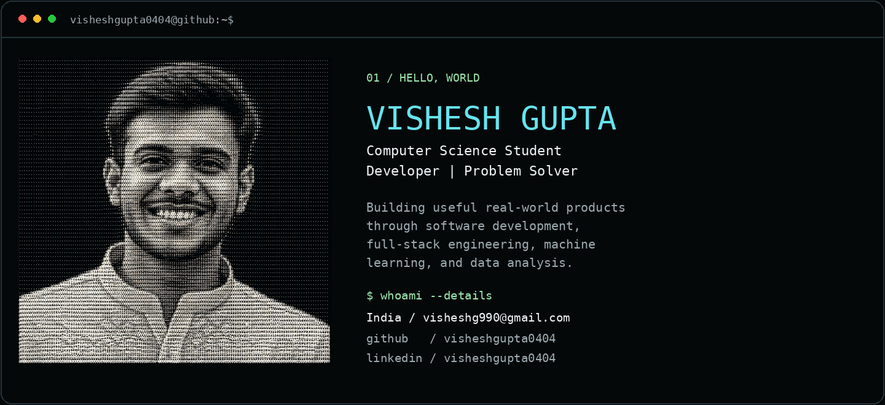
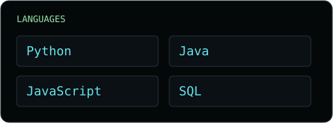
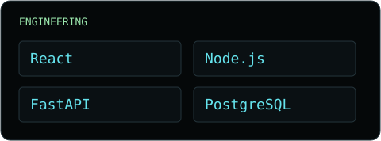
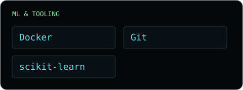
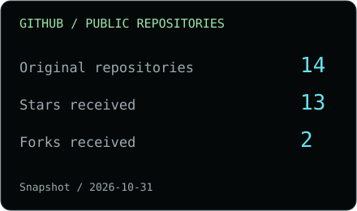
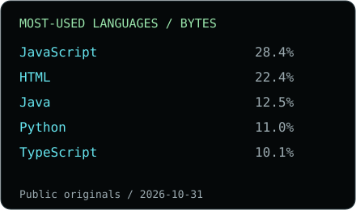

<picture>
  <source media="(max-width: 640px)" srcset="assets/terminal-hero-mobile.png">
  
</picture>

  <a href="https://github.com/visheshgupta0404">GitHub</a> ·
  <a href="https://www.linkedin.com/in/visheshgupta0404">LinkedIn</a> ·
  <a href="https://leetcode.com/u/visheshgupta0404/">LeetCode</a> ·
  <a href="mailto:visheshg990@gmail.com">Email</a>

## `~/stack`

  

## `~/projects` Selected work

<a href="https://github.com/visheshgupta0404/Syncora"><picture><source media="(max-width: 640px)" srcset="assets/project-syncora-mobile.svg"></picture></a>

[Source ↗](https://github.com/visheshgupta0404/Syncora) · [Launch Syncora ↗](https://syncoramoments.pages.dev/)

<a href="https://github.com/visheshgupta0404/PlagLe"><picture><source media="(max-width: 640px)" srcset="assets/project-plagle-mobile.svg"></picture></a>

[Source ↗](https://github.com/visheshgupta0404/PlagLe)

<a href="https://github.com/visheshgupta0404/ExamEngine"><picture><source media="(max-width: 640px)" srcset="assets/project-examengine-mobile.svg"></picture></a>

[Source ↗](https://github.com/visheshgupta0404/ExamEngine) · [Open ExamEngine ↗](https://visheshgupta0404.github.io/ExamEngine/)

<a href="https://visheshgupta0404.github.io/DispatchLens/"><picture><source media="(max-width: 640px)" srcset="assets/project-dispatchlens-mobile.svg"></picture></a>

[Explore DispatchLens ↗](https://visheshgupta0404.github.io/DispatchLens/) · Private source · historical data

## `~/activity`

[Repositories](https://github.com/visheshgupta0404?tab=repositories) · [Contribution activity](https://github.com/visheshgupta0404?tab=overview) · [Public commits](https://github.com/search?q=author%3Avisheshgupta0404&type=commits)

 

Statistics are dated snapshots from the GitHub API. Language bytes describe repository code, not proficiency. Follow Contribution activity above for GitHub's current contribution calendar.

---

`$ ./connect --ideas --code --collaborate`

[GitHub](https://github.com/visheshgupta0404) · [LinkedIn](https://www.linkedin.com/in/visheshgupta0404) · [LeetCode](https://leetcode.com/u/visheshgupta0404/) · [visheshg990@gmail.com](mailto:visheshg990@gmail.com)

Code with purpose. Build something useful. Keep learning.
