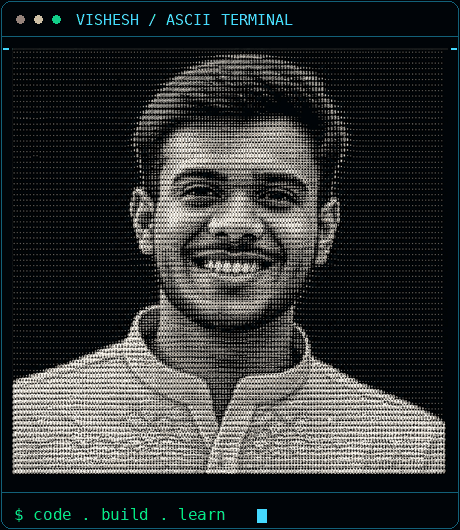
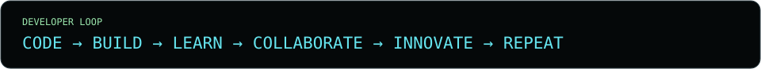
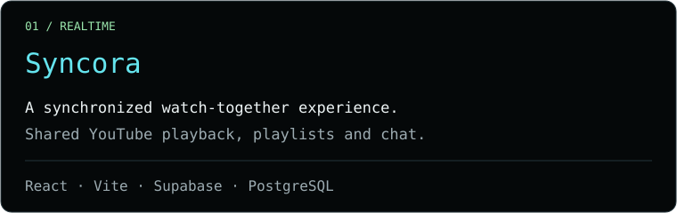
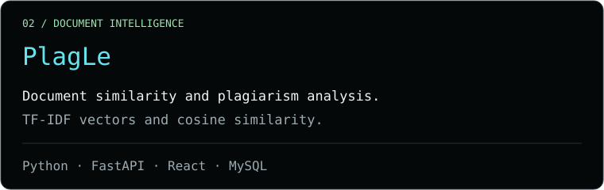
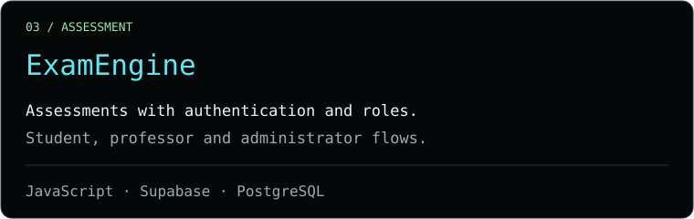
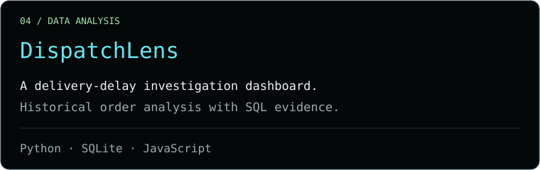

<table>
<tr>
<td width="32%" valign="middle">
<picture><source media="(prefers-reduced-motion: reduce)" srcset="assets/ascii-portrait.png"></picture>
</td>
<td valign="top">

## `VISHESH GUPTA_`

**`Computer Science Student`** 
**`Developer · Problem Solver`**

I build useful real-world products through **software development**, **full-stack engineering**, **machine learning**, and **data analysis**.

`$ build → test → learn → improve`

</td>
</tr>
</table>

| Category | Technologies used across my repositories |
| :--- | :--- |
| **Languages & web basics** |     TypeScript · HTML · CSS · Arduino C++ |
| **Frontend & UI** |  Next.js · Tailwind CSS · Bootstrap · Framer Motion · React Router |
| **Backend & realtime** |   Express · Flask · Socket.IO · Pydantic · Zod |
| **SQL databases** |  MySQL · SQLite · DuckDB · PGlite |
| **NoSQL & caching** | MongoDB · Firestore · Redis |
| **Backend services** | Supabase · Firebase Authentication · Firebase Storage · Neon |
| **Machine learning & data** |  NumPy · pandas · SciPy · NLTK · XGBoost |
| **Charts & maps** | Matplotlib · Plotly · Chart.js · Recharts · deck.gl · MapLibre GL |
| **Mobile, games & hardware** | Android SDK · AndroidX · Material Components · Phaser · Arduino Uno |
| **Development & delivery** |   GitHub Actions · Vite · esbuild · Gradle · pytest · Playwright · ESLint · Prettier · Ruff |

Supporting libraries & integrations

- **Web & APIs:** React Router, Axios, React Bootstrap, React Select, Lucide, React Map GL, React Plotly, React Chart.js, PWA tooling, KaTeX, Web Audio.
- **Database access:** SQLAlchemy, Mongoose, psycopg2, node-postgres, MySQL Connector, PGlite, Neon.
- **Documents & data:** PyPDF2, python-docx, ReportLab, Pillow, openpyxl, RapidFuzz, joblib, yfinance, pandas-market-calendars, Parquet.
- **Services & validation:** Google Gen AI SDK, iron-session, JSZip, HTTPX, Uvicorn, Gunicorn, Waitress.
- **Android:** Firebase Authentication, Firebase Storage, OkHttp, Glide, View Binding, Data Binding, JUnit, Espresso.
- **Tooling & hosting:** npm, PostCSS, Autoprefixer, jsdom, Node.js test runner, GitHub Pages, Cloudflare Pages, Vercel.

Grouped from project source, dependency manifests and documentation; supporting libraries are collapsed to keep the page readable.

[Source ↗](https://github.com/visheshgupta0404/Syncora) · [Open live project ↗](https://syncoramoments.pages.dev/)

[Source ↗](https://github.com/visheshgupta0404/PlagLe)

[Source ↗](https://github.com/visheshgupta0404/ExamEngine) · [Open live project ↗](https://visheshgupta0404.github.io/ExamEngine/)

Private source · [Open live project ↗](https://visheshgupta0404.github.io/DispatchLens/)

---

[LinkedIn](https://www.linkedin.com/in/visheshgupta0404) · [GitHub](https://github.com/visheshgupta0404) · [LeetCode](https://leetcode.com/u/visheshgupta0404/) · [visheshg990@gmail.com](mailto:visheshg990@gmail.com)

