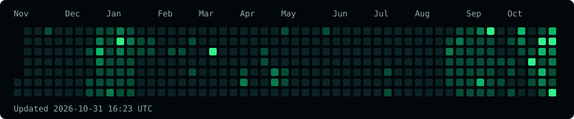

<table>
<tr>
<td width="36%" valign="middle">
<picture><source media="(prefers-reduced-motion: reduce)" srcset="assets/ascii-portrait.png"></picture>
</td>
<td valign="top">

# `VISHESH GUPTA_`

**`Computer Science Student`**<br>
**`Developer · Problem Solver`**

I build useful real-world products through **software development**, **full-stack engineering**, **machine learning**, and **data analysis**.

<p>
<a href="https://www.linkedin.com/in/visheshgupta0404"></a>
<a href="https://github.com/visheshgupta0404"></a>
<a href="mailto:visheshg990@gmail.com"></a>
<a href="https://leetcode.com/u/visheshgupta0404/"></a>
</p>

```js
const mindset = {
  learn: "always",
  build: "useful products",
  improve: "every day"
};
```

</td>
</tr>
</table>


| Languages | Engineering | ML & tools |
| :--- | :--- | :--- |
| [Python](https://www.python.org/) | [React](https://react.dev/) | [scikit-learn](https://scikit-learn.org/) |
| [Java](https://dev.java/) | [Node.js](https://nodejs.org/) | [Docker](https://www.docker.com/) |
| [JavaScript](https://developer.mozilla.org/en-US/docs/Web/JavaScript) | [FastAPI](https://fastapi.tiangolo.com/) | [Git](https://git-scm.com/) |
| [SQL](https://www.postgresql.org/docs/current/sql.html) | [PostgreSQL](https://www.postgresql.org/) | |


<table>
<tr>
<td width="50%" valign="top">

### [01 / Syncora ↗](https://github.com/visheshgupta0404/Syncora)

A synchronized watch-together experience with shared YouTube playback, playlists and live chat.

`React` `Vite` `Supabase` `PostgreSQL`

[Source](https://github.com/visheshgupta0404/Syncora) · [Launch app ↗](https://syncoramoments.pages.dev/)

</td>
<td width="50%" valign="top">

### [02 / PlagLe ↗](https://github.com/visheshgupta0404/PlagLe)

Document similarity and plagiarism analysis using TF-IDF vectors and cosine similarity.

`Python` `FastAPI` `React` `MySQL`

[Explore source ↗](https://github.com/visheshgupta0404/PlagLe)

</td>
</tr>
<tr>
<td valign="top">

### [03 / ExamEngine ↗](https://github.com/visheshgupta0404/ExamEngine)

An assessment platform with authentication and student, professor and administrator roles.

`JavaScript` `Supabase` `PostgreSQL`

[Source](https://github.com/visheshgupta0404/ExamEngine) · [Launch app ↗](https://visheshgupta0404.github.io/ExamEngine/)

</td>
<td valign="top">

### [04 / DispatchLens ↗](https://visheshgupta0404.github.io/DispatchLens/)

A historical delivery-delay analytics dashboard with SQL-backed investigation.

`Python` `SQLite` `JavaScript`

[Open dashboard ↗](https://visheshgupta0404.github.io/DispatchLens/) · private source

</td>
</tr>
</table>


<!-- ACTIVITY:START -->

**Last refreshed:** 2026-10-31 16:19 UTC

| Public original repositories | Stars received | Forks received |
| :---: | :---: | :---: |
| 14 | 13 | 2 |

**Most-used languages**

| Language | Share of code bytes |
| :--- | ---: |
| JavaScript | 27.9% |
| HTML | 22.1% |
| Java | 12.3% |
| Python | 12.3% |
| TypeScript | 9.9% |

**Recently pushed repositories**

- [visheshgupta0404](https://github.com/visheshgupta0404/visheshgupta0404) · 2026-10-31
- [FixOnce](https://github.com/visheshgupta0404/FixOnce) · 2026-10-31
- [QuestOS](https://github.com/visheshgupta0404/QuestOS) · 2026-10-31

<!-- ACTIVITY:END -->

[](https://github.com/visheshgupta0404?tab=overview)

[Current contribution activity ↗](https://github.com/visheshgupta0404?tab=overview) · [All repositories ↗](https://github.com/visheshgupta0404?tab=repositories) · [Refresh workflow ↗](https://github.com/visheshgupta0404/visheshgupta0404/actions/workflows/refresh-profile.yml)

<sub>Activity refreshes daily through GitHub Actions. The timestamp above shows the last successful refresh. Repository and language metrics cover public original repositories; language bytes are not proficiency ratings.</sub>

---

`$ ./connect --ideas --code --collaborate`

[LinkedIn](https://www.linkedin.com/in/visheshgupta0404) · [GitHub](https://github.com/visheshgupta0404) · [LeetCode](https://leetcode.com/u/visheshgupta0404/) · [visheshg990@gmail.com](mailto:visheshg990@gmail.com)
