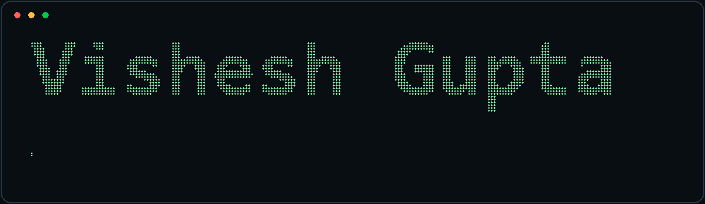

<div align="center">

```text
┌──────────────────────────────────────────────────────────────────┐
│  ●  ●  ●    vishesh@github:~$ ./introduce --developer           │
└──────────────────────────────────────────────────────────────────┘
```

# `> VISHESH GUPTA_`

**`AI / ML`** · **`DATA ANALYTICS`** · **`FULL-STACK DEVELOPMENT`**

*Building useful systems from ideas, data, and code.*



[](https://www.linkedin.com/in/visheshgupta0404)
[](mailto:visheshg990@gmail.com)
[](https://leetcode.com/u/visheshgupta0404/)

`[ about ]` · `[ projects ]` · `[ stack ]` · `[ stats ]`

</div>

## `> whoami`

```python
developer = {
    "name": "Vishesh Gupta",
    "education": "B.Tech Computer Science · BML Munjal University",
    "focus": ["Machine Learning", "Data Analytics", "Full-Stack Systems"],
    "principles": ["build", "test", "learn", "iterate"],
}
```

I build data-driven applications, NLP tools, real-time products, and practical web systems. I care about reliable engineering, meaningful evaluation, and turning ideas into useful software.

## `> ls projects/`

| Project | What it does | Stack |
|:--|:--|:--|
| **[Syncora](https://github.com/visheshgupta0404/Syncora)** | Watch-together rooms, synchronized YouTube playback, playlists and live chat · [Live](https://syncoramoments.pages.dev/) | React · Supabase · PostgreSQL |
| **[PlagLe](https://github.com/visheshgupta0404/PlagLe)** | Document similarity with TF-IDF, cosine similarity and PDF reporting | Python · FastAPI · React · MySQL |
| **[ExamEngine](https://github.com/visheshgupta0404/ExamEngine)** | Role-based assessment system with timed attempts, autosave and grading · [Live](https://visheshgupta0404.github.io/ExamEngine/) | JavaScript · Supabase · PostgreSQL |
| **[DispatchLens](https://visheshgupta0404.github.io/DispatchLens/)** | SQL-backed investigation of historical delivery delays · private source | Python · SQLite · Analytics |
| **[NIFTY 50 Direction Prediction](https://github.com/visheshgupta0404/nifty50-direction-prediction)** | Chronologically evaluated time-series ML research · private source | Python · XGBoost · scikit-learn |
| **[RoleRadar](https://github.com/visheshgupta0404/RoleRadar)** | Job-skill intelligence with traceable extraction and reports · private source | Python · SQLite · DuckDB |

<sub>Private repositories require access. Research projects are prototypes, not claims of production performance.</sub>

## `> cat stack.txt`

<p align="center">

</p>

```text
stack/
├── ai-ml         pandas · NumPy · scikit-learn · XGBoost · NLTK
├── analytics     SQL · Plotly · Recharts · data pipelines
├── frontend      React · Tailwind CSS · Vite
├── backend       Node.js · Express · FastAPI · Flask
├── realtime      Supabase Realtime · Socket.IO
├── databases     PostgreSQL · MySQL · MongoDB · SQLite
└── tooling       Git · GitHub Actions · Docker Compose
```

## `> git status --profile`

<div align="center">


</div>

<sub>Statistics are served by a third-party widget and may occasionally be unavailable.</sub>

## `> ./connect.sh`

<div align="center">

`ideas → code → tests → iterate`

[GitHub repositories](https://github.com/visheshgupta0404?tab=repositories) · [LinkedIn](https://www.linkedin.com/in/visheshgupta0404) · [Email](mailto:visheshg990@gmail.com)

`$ echo "Good code. Better ideas. Bigger impact."`

</div>
